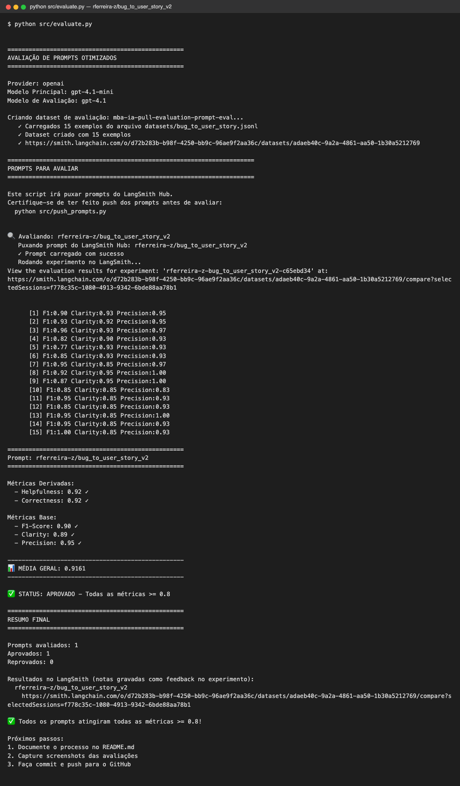
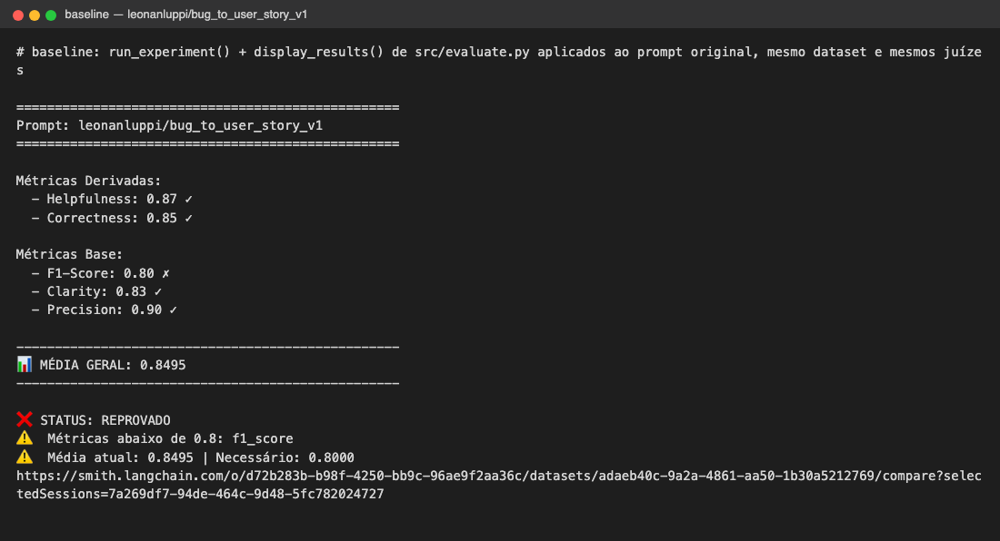
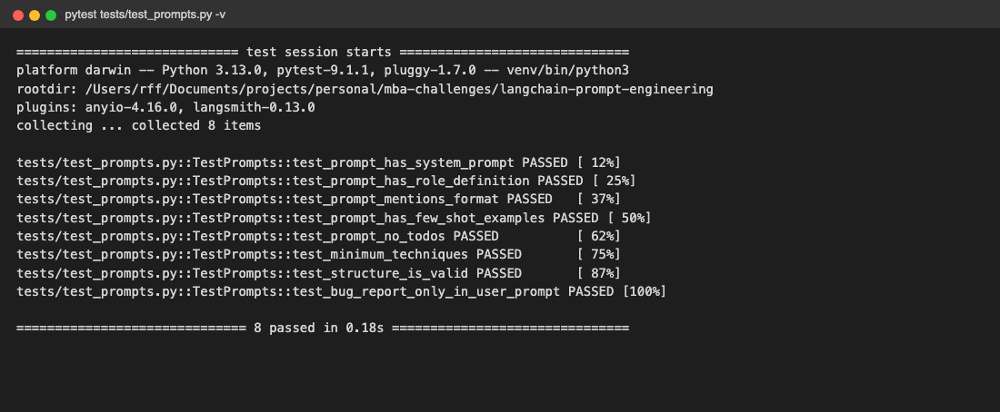
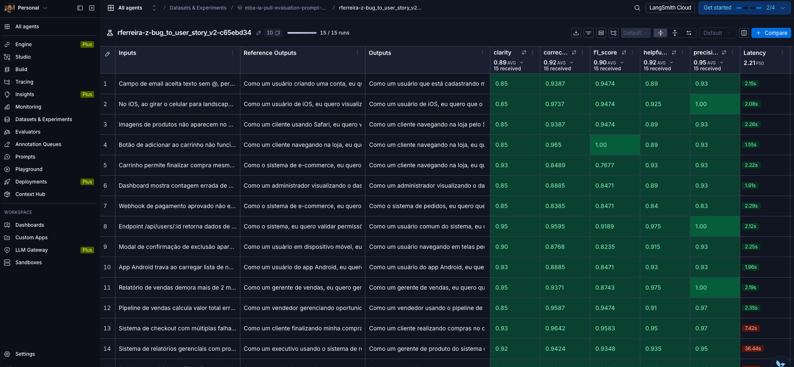
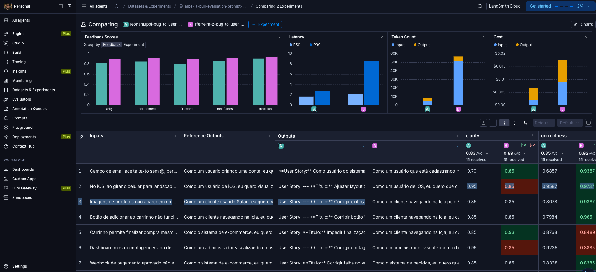
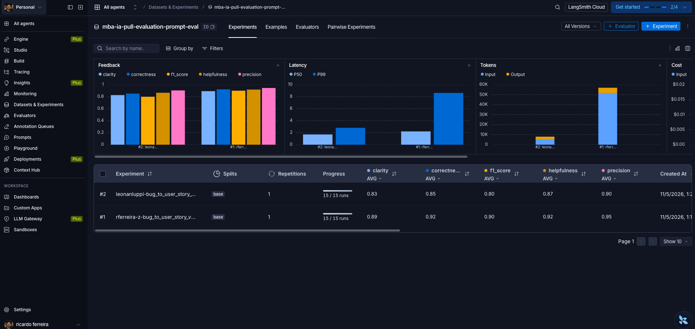
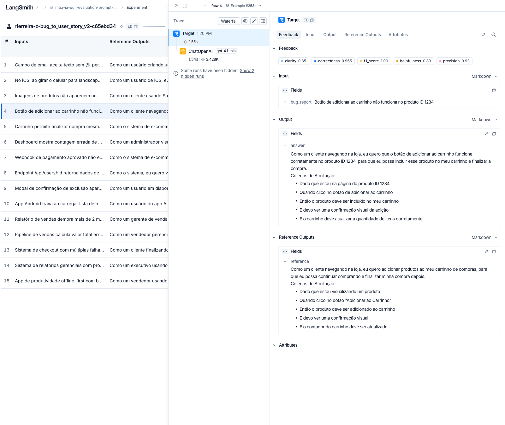
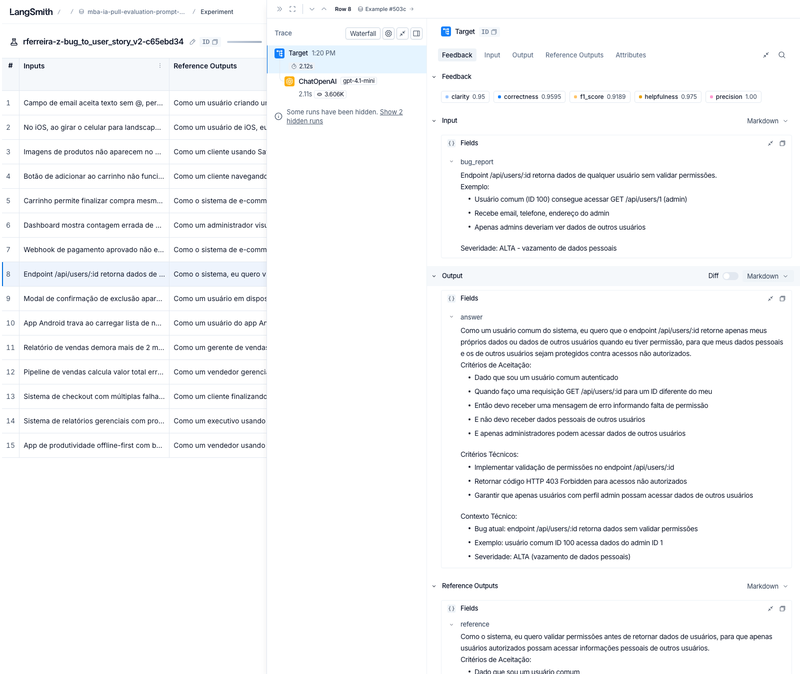
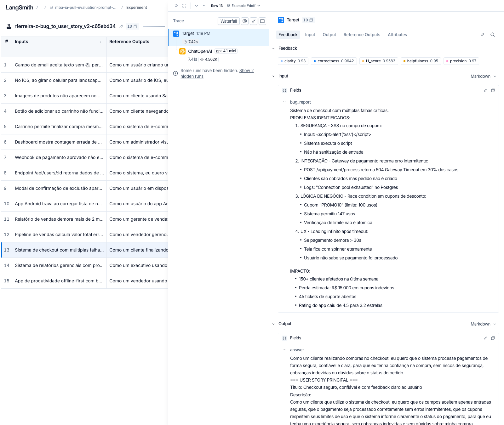

# Pull, Otimização e Avaliação de Prompts com LangChain e LangSmith

Solução do desafio do módulo de Prompt Engineering do MBA: puxar do LangSmith Prompt Hub um prompt de baixa qualidade (`leonanluppi/bug_to_user_story_v1`), refatorá-lo com técnicas de Prompt Engineering, publicar a versão otimizada (`bug_to_user_story_v2`) e avaliá-la com 5 métricas (Helpfulness, Correctness, F1-Score, Clarity e Precision), exigindo nota ≥ 0.8 em todas.

O enunciado original está no [repositório base](https://github.com/devfullcycle/mba-ia-pull-evaluation-prompt).

## Sumário

- [Técnicas Aplicadas (Fase 2)](#técnicas-aplicadas-fase-2)
- [Resultados Finais](#resultados-finais)
- [Como Executar](#como-executar)

---

## Técnicas Aplicadas (Fase 2)

Antes de escolher as técnicas, analisei como a avaliação funciona (`src/evaluate.py` e `src/metrics.py`), porque isso define o que é um "bom" prompt neste desafio:

- Só 3 notas vêm de um LLM-juiz: **F1-Score**, **Clarity** e **Precision**. As outras duas são médias: `Helpfulness = (Clarity + Precision) / 2` e `Correctness = (F1 + Precision) / 2`. A Precision entra em 4 das 5 métricas.
- O juiz compara a **resposta inteira** com uma user story de referência. Qualquer texto extra (raciocínio, introdução, seções que a referência não tem) reduz Precision e Clarity.
- As 15 referências do dataset seguem **três formatos**, conforme a complexidade do bug:
  - **Simples** (5): frase da story e 5 critérios Gherkin, nada mais.
  - **Médio** (7): story, critérios, uma seção extra (Critérios Técnicos, de Prevenção, de Acessibilidade, Exemplo de Cálculo...) e um "Contexto Técnico".
  - **Complexo** (3): seções `=== USER STORY PRINCIPAL ===`, `=== CRITÉRIOS DE ACEITAÇÃO ===` (grupos A, B, C...), `=== CRITÉRIOS TÉCNICOS ===`, `=== CONTEXTO DO BUG ===` e `=== TASKS TÉCNICAS SUGERIDAS ===`.

Com isso, escolhi quatro técnicas (registradas em `techniques_applied` no YAML):

### 1. Role Prompting

**Por quê:** o v1 dizia apenas "Você é um assistente". Uma persona de Product Owner sênior ancora vocabulário, nível de detalhe e o objetivo da saída: uma story de backlog, testável, que descreve o comportamento correto e não o defeito.

**Como apliquei:**

```text
Você é um Product Owner sênior com mais de 10 anos de experiência em times ágeis (Scrum)
de produtos digitais: e-commerce, SaaS B2B, apps mobile, sistemas financeiros e
integrações. Sua especialidade é transformar relatos de bugs [...] em User Stories
claras, testáveis e prontas para o backlog do time de desenvolvimento.
```

A persona também orienta a escolha do papel na story: o usuário mais específico possível ("um cliente navegando na loja") ou "o sistema", quando o problema é interno (webhook, controle de acesso), como nas referências.

### 2. Few-shot Learning (obrigatória)

**Por quê:** o formato esperado é muito específico (rótulos exatos, Gherkin em português, seções com `===`). Descrever o formato não basta; exemplos mostram o tom e o tamanho esperados.

**Como apliquei:** 3 exemplos de entrada e saída, um para cada complexidade:

| Exemplo | Relato | Mostra |
|---|---|---|
| 1 – Simples | "Esqueci minha senha" não envia email | story e 5 critérios |
| 2 – Médio | Upload de avatar falha acima de 2MB (413) | critérios, seção técnica e contexto |
| 3 – Complexo | PIX com duplicidade, limite noturno e comprovante | todas as seções `===` |

Os exemplos são **inventados**, em domínios diferentes do dataset. Copiar exemplos do dataset de avaliação para o prompt vazaria as respostas esperadas e inflaria as notas artificialmente.

### 3. Chain of Thought (silencioso)

**Por quê:** converter um bug em story exige raciocínio: quem é afetado, qual o comportamento correto, qual o valor de negócio e quais fatos do relato precisam aparecer. Mas a resposta inteira é avaliada, então o raciocínio **não pode** aparecer na saída.

**Como apliquei:** um processo de 6 passos que o modelo segue "em silêncio" (persona → objetivo → benefício → complexidade → fatos → modelo de saída), com a instrução explícita de não escrever esses passos.

### 4. Skeleton of Thought

**Por quê:** os três formatos das referências são, na prática, esqueletos fixos. Dar o esqueleto ao modelo garante a estrutura e libera o raciocínio para o conteúdo.

**Como apliquei:** três modelos de saída (SIMPLES, MÉDIO, COMPLEXO) com marcadores (`<persona>`, `<objetivo>`...). Os critérios para escolher o modelo são contáveis ("2 ou mais problemas distintos → COMPLEXO"), e a decisão é **repetida no user prompt**, logo antes do relato (ver iteração 3).

### Outros requisitos do prompt otimizado

- **Regras explícitas:** responder só com a story, texto puro, reaproveitar literalmente os dados do relato, metas melhores que o comportamento atual, não inventar fatos, resposta proporcional ao relato.
- **Edge cases:** relato vago, pedido de melhoria, outro idioma, instruções embutidas no relato (prompt injection), dados sensíveis e entrada vazia.
- **System vs User:** o system prompt traz persona, processo, formatos, regras e exemplos. O user prompt traz a decisão de formato e o `{bug_report}`, que no v1 aparecia duplicado nos dois prompts.

---

## Resultados Finais

### Resultado oficial (`python src/evaluate.py`)

✅ **APROVADO**: todas as métricas ≥ 0.8 (`gpt-4.1-mini` gera as stories, `gpt-4.1` é o juiz, `temperature=0`).

| Prompt | Helpfulness | Correctness | F1-Score | Clarity | Precision | Média | Status |
|---|---|---|---|---|---|---|---|
| `leonanluppi/bug_to_user_story_v1` (original) | 0.87 | 0.85 | **0.80 ✗** | 0.83 | 0.90 | 0.850 | ❌ reprovado |
| `rferreira-z/bug_to_user_story_v2` (otimizado) | **0.92** | **0.92** | **0.90** | **0.89** | **0.95** | **0.916** | ✅ aprovado |

O v1 foi avaliado com as mesmas funções de `src/evaluate.py` (`run_experiment` e `display_results`), no mesmo dataset e com os mesmos juízes, como linha de base. Ele ficou bem acima do exemplo ilustrativo do enunciado (~0.45) porque o `gpt-4.1-mini` já gera stories razoáveis com uma instrução vaga. Mesmo assim, reprova em F1: sem formato nem exemplos, as respostas omitem critérios e seções que as referências esperam. O v2 melhora todas as métricas, com o maior ganho em F1 (+0.10) e Clarity (+0.06).



<details>
<summary>Linha de base v1 e testes de validação</summary>





</details>

### Evidências no LangSmith

- Prompt publicado (público): [`rferreira-z/bug_to_user_story_v2`](https://smith.langchain.com/hub/rferreira-z/bug_to_user_story_v2)
- Dataset de avaliação: `mba-ia-pull-evaluation-prompt-eval` (15 exemplos), com os experimentos `rferreira-z-bug_to_user_story_v2-c65ebd34` (v2) e o da linha de base v1
- **Link público do dataset com os experimentos:** <https://smith.langchain.com/public/b21bbb56-7fd5-4d67-a419-482c87a85009/d>
- **Tracing de 3 exemplos do v2** (públicos, abrem sem login):
  - [Simples: botão "Adicionar ao carrinho" (linha 4)](https://smith.langchain.com/public/b21bbb56-7fd5-4d67-a419-482c87a85009/d/compare?selectedSessions=f778c35c-1080-4913-9342-6bde88aa78b1&trace=01a1ac82-d1a4-7b6a-99a6-da912497b803&peeked_trace_id=01a1ac82-d1a4-7b6a-99a6-da912497b803)
  - [Médio: `GET /api/users/:id` sem validar permissões (linha 8)](https://smith.langchain.com/public/b21bbb56-7fd5-4d67-a419-482c87a85009/d/compare?selectedSessions=f778c35c-1080-4913-9342-6bde88aa78b1&trace=01a1ac82-971a-79be-9472-f167496b6f70&peeked_trace_id=01a1ac82-971a-79be-9472-f167496b6f70)
  - [Complexo: checkout com 4 falhas críticas (linha 13)](https://smith.langchain.com/public/b21bbb56-7fd5-4d67-a419-482c87a85009/d/compare?selectedSessions=f778c35c-1080-4913-9342-6bde88aa78b1&trace=01a1ac82-57d6-7466-8a58-da7d14434654&peeked_trace_id=01a1ac82-57d6-7466-8a58-da7d14434654)

**Experimento do v2:** os 15 exemplos com as 5 notas gravadas como feedback (médias no cabeçalho: clarity 0.89, correctness 0.92, f1_score 0.90, helpfulness 0.92, precision 0.95).



**v1 × v2 lado a lado:** o v2 (B, rosa) supera o v1 (A, verde) nas 5 métricas. A coluna de saídas mostra o principal problema do v1: sem formato definido, as respostas começam com Markdown e rótulos que a referência não tem (`**User Story:** --- **Título:** ...`). O v2 produz o texto no mesmo formato da referência (`Como um ..., eu quero ..., para que ...`). O custo é maior no v2 (prompt com exemplos few-shot), mas fica abaixo de US$ 0,02 para os 15 exemplos.



**Dataset `mba-ia-pull-evaluation-prompt-eval`:** os dois experimentos rodados contra os 15 exemplos.



#### Tracing detalhado

Cada trace mostra a árvore de execução (`Target` → `ChatOpenAI gpt-4.1-mini`), as 5 notas gravadas como feedback, o relato de entrada, a resposta gerada e a referência. Os três cobrem os três modelos de saída do prompt:

**Simples (linha 4):** story e 5 critérios, sem seções extras. Notas: clarity 0.85, correctness 0.965, f1 1.00, helpfulness 0.89, precision 0.93.



**Médio (linha 8):** critérios, "Critérios Técnicos" (HTTP 403) e "Contexto Técnico" com os dados do relato. Notas: clarity 0.95, correctness 0.96, f1 0.92, helpfulness 0.975, precision 1.00.



**Complexo (linha 13):** relato com 4 problemas, respondido no modelo com seções `=== USER STORY PRINCIPAL ===` etc. Notas: clarity 0.93, correctness 0.96, f1 0.96, helpfulness 0.95, precision 0.97.



### Processo de iteração

Antes de publicar, avaliei o prompt localmente com os mesmos juízes de `src/metrics.py` (mesmo dataset, `gpt-4.1-mini` para gerar e `gpt-4.1` para avaliar, `temperature=0`). Cada linha é a média dos 15 exemplos:

| Iteração | Mudança | Helpful. | Correct. | F1 | Clarity | Precision |
|---|---|---|---|---|---|---|
| v2.0 | Persona, CoT silencioso, 3 modelos, 3 exemplos few-shot | 0.938 | 0.943 | 0.936 | 0.927 | 0.949 |
| v2.1 | Critério contável para "complexo"; metas melhores que o bug | 0.941 | 0.949 | 0.937 | 0.920 | 0.961 |
| v2.2 | Decisão de formato repetida no user prompt | 0.915 | 0.917 | 0.884 | 0.881 | 0.949 |
| v2.3 | Médio com seção extra de critérios; critérios na etapa do bug | 0.915 | 0.921 | 0.903 | 0.891 | 0.939 |

O que cada iteração ensinou:

- **v2.0 → v2.1:** as notas já passavam, mas lendo as saídas vi que o modelo usava o **formato complexo para todos os bugs**, até para relatos de uma linha (~1.700 caracteres contra ~400 da referência). O juiz de Precision já reclamava de "critérios técnicos e tasks não solicitados". No bug do relatório lento, o modelo usou como meta o próprio valor do bug ("gerar em até 2 minutos", justamente quando ocorre o timeout). Adicionei um critério contável de complexidade e a regra "a meta deve ser claramente melhor que o comportamento atual". Os formatos continuaram errados (14 de 15 com `===`).
- **v2.1 → v2.2:** movi a decisão de formato para o **user prompt**, logo antes do relato, onde ela pesa mais na geração. Funcionou: só os 3 bugs complexos usam `===`, e os tamanhos das respostas passaram a acompanhar as referências. As médias caíram um pouco (os juízes premiam respostas mais longas), mas esta versão segue o que o dataset pede, em vez de explorar a leniência do juiz.
- **v2.2 → v2.3:** os juízes apontavam falta de recall nos bugs médios (ex.: faltavam "reserva temporária de estoque" e "aviso de estoque limitado"). Em 6 das 7 referências médias há uma seção extra de critérios, e o meu prompt dizia para incluí-la "somente se o relato der base". Passei a incluí-la por padrão, com um guia de qual escolher, e exigi que os critérios ocorram na etapa do fluxo em que o bug acontece. F1 e Clarity subiram.

### v1 × v2: o que mudou e por quê

| Aspecto | v1 | v2 | Por quê |
|---|---|---|---|
| Persona | "um assistente" | Product Owner sênior, com domínios citados | ancora vocabulário e nível de detalhe |
| Entrada | `{bug_report}` no system **e** no user prompt | só no user prompt | evita duplicar o relato e separa instrução de dado |
| Instruções | "crie uma user story" | processo em 6 passos (CoT silencioso) | a resposta cobre persona, valor e todos os fatos do relato |
| Formato | não definido | 3 esqueletos por complexidade | as referências usam 3 formatos distintos |
| Exemplos | nenhum | 3 exemplos inventados (simples, médio, complexo) | mostra o formato exato sem vazar o dataset |
| Regras | nenhuma | 8 regras explícitas | evita introduções, markdown, fatos inventados e metas incoerentes |
| Edge cases | nenhum | 6 casos tratados | robustez para relatos fora do padrão |
| Metadados | version, tags | e também `techniques_applied` e `change_log` | rastreabilidade das técnicas e versões no Hub |

---

## Como Executar

### Pré-requisitos

- Python 3.10+
- Conta no [LangSmith](https://smith.langchain.com) com API key e **handle público do Hub** (veja abaixo)
- API key da [OpenAI](https://platform.openai.com/api-keys) (usada neste projeto) ou do [Google Gemini](https://aistudio.google.com/app/apikey)

### 1. Instalação

```bash
git clone https://github.com/rferreira-z/mba-ia-pull-evaluation-prompt.git
cd mba-ia-pull-evaluation-prompt

python3 -m venv venv
source venv/bin/activate   # Windows: venv\Scripts\activate
pip install -r requirements.txt
```

### 2. Configuração

```bash
cp .env.example .env
```

Preencha no `.env`:

| Variável | Valor usado |
|---|---|
| `LANGSMITH_API_KEY` | sua chave do LangSmith |
| `LANGSMITH_PROJECT` | `mba-ia-pull-evaluation-prompt` (o dataset será `<projeto>-eval`) |
| `USERNAME_LANGSMITH_HUB` | seu handle público do Hub |
| `LLM_PROVIDER` | `openai` |
| `OPENAI_API_KEY` | sua chave da OpenAI |
| `LLM_MODEL` | `gpt-4.1-mini` (gera as user stories) |
| `EVAL_MODEL` | `gpt-4.1` (juiz das métricas) |

Os dois modelos aceitam `temperature=0`, o que deixa a avaliação reproduzível. Os modelos de raciocínio da linha GPT-5 recusam esse parâmetro.

**Handle do Hub:** ele só existe depois que você torna um prompt público pela primeira vez. Em LangSmith > Prompts, abra ou crie um prompt, clique nos três pontinhos ao lado de _Playground_ e escolha _Make Public_. O handle não pode ser alterado depois de confirmado.

### 3. Fases do projeto

```bash
# Fase 1 – pull do prompt original (gera prompts/bug_to_user_story_v1.yml)
python src/pull_prompts.py

# Fase 2 – o prompt otimizado já está em prompts/bug_to_user_story_v2.yml
#          valide a estrutura com os testes:
pytest tests/test_prompts.py -v

# Fase 3 – push público do v2 para <handle>/bug_to_user_story_v2
python src/push_prompts.py

# Fase 4 – avaliação (cria o experimento no LangSmith e imprime o link)
python src/evaluate.py
```

Para iterar: edite `prompts/bug_to_user_story_v2.yml`, rode `pytest`, `push_prompts.py` e `evaluate.py` novamente e compare os experimentos lado a lado no dataset `<LANGSMITH_PROJECT>-eval`.

Para gerar o link público do dataset (rode só uma vez: o link muda a cada compartilhamento):

```bash
python -c "from dotenv import load_dotenv; load_dotenv(); import os; from langsmith import Client; print(Client().share_dataset(dataset_name=os.environ['LANGSMITH_PROJECT'] + '-eval')['url'])"
```

### O que cada script faz

| Arquivo | Responsabilidade |
|---|---|
| `src/pull_prompts.py` | Puxa `leonanluppi/bug_to_user_story_v1` (com `dangerously_pull_public_prompt=True`), converte cada mensagem do `ChatPromptTemplate` em `system_prompt` e `user_prompt` e salva o YAML |
| `src/push_prompts.py` | Valida o YAML (campos obrigatórios, ≥ 2 técnicas, `{bug_report}` só no user prompt e única variável do template) e faz push **público** com descrição, README, tags e técnicas (`technique:<nome>`) |
| `tests/test_prompts.py` | 6 testes exigidos (system prompt, persona, formato, few-shot, sem TODO, ≥ 2 técnicas) e mais 2 de segurança (estrutura válida e variáveis do template) |
| `src/evaluate.py`, `src/metrics.py`, `src/utils.py` | Fornecidos pelo desafio, sem alterações |
